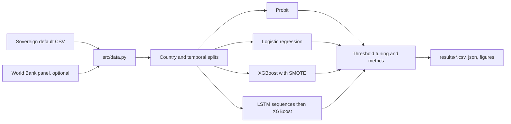

# Sovereign Default Prediction

Code for my MSc thesis on predicting sovereign debt defaults. It compares a Probit model, logistic regression, XGBoost and a hybrid LSTM plus XGBoost model on a country by year panel, using splits that avoid leaking the same country or future years into training. It is meant for anyone reviewing the thesis or reusing the evaluation setup.

See [FAILURES.md](FAILURES.md) for what went wrong in the earlier notebooks and how it was fixed, and [THESIS_ALIGNMENT_AUDIT.md](THESIS_ALIGNMENT_AUDIT.md) for how the thesis text maps to the code.

## Read this first: the results are weak and the data is unverified

- **None of the models predicts defaults well.** On the held out data, ROC AUC sits between about 0.42 and 0.59 and the best default class F1 is about 0.12. That is close to chance. Earlier drafts quoted an AUC band of 0.68 to 0.72; the pipeline in this repo does not reproduce that.
- **The source of the main dataset is not documented, and the values do not look like real macro data.** For example, Nigeria in 1980 has a GDP per capita of about 52,259 USD, every country has a median GDP per capita between roughly 23,000 and 37,000 USD, and a VIX value appears for 1980 (the VIX index starts in 1990). Treat the file as synthetic or unverified until its origin is confirmed.

## What it does

- Loads a panel of 68 countries from 1980 to 2022 (3,011 rows, default rate 5.48%).
- Optionally overlays World Bank indicators from `data_out/panel_final.csv`.
- Evaluates four models on two splits:
  - **Country hold out**: 54 countries for training, 14 different countries for testing.
  - **Temporal**: train on years up to 2010, test on later years.
- Tunes the decision threshold on training data only (nested cross validation), applies SMOTE to training data only, and reports F1, recall, precision, PR AUC and ROC AUC rather than accuracy.

## How it works



## Quick start

Tested with Python 3.11 on Linux. TensorFlow is a large install.

```bash
python3.11 -m venv .venv
source .venv/bin/activate
pip install -r requirements.txt
python -m pytest tests -q          # about 1 minute
python run_evaluation.py           # about 13 minutes on an 8 vCPU machine
```

Warning: `run_evaluation.py` also embeds two ROC figures into `extras/THESIS_OBANOR_TEHILLA_49_.docx` and writes a backup copy next to it. `scripts/regenerate_thesis_results.py` and `scripts/patch_thesis.py` rewrite tables and text in that document. Run them on a copy if you want to keep the committed thesis unchanged.

To rebuild the optional World Bank panel:

```bash
pip install -r requirements-dev.txt
python scripts/build_panel.py
```

## Real output

Committed results in `results/` (country hold out: 602 test rows with 35 defaults; the hybrid model uses sequences, so 532 rows with 32 defaults):

| Model | F1 (default) | ROC AUC |
| --- | --- | --- |
| Hybrid (LSTM + XGBoost) | 0.122 | 0.509 |
| Probit | 0.121 | 0.563 |
| Logistic regression | 0.110 | 0.559 |
| XGBoost | 0.100 | 0.494 |

Temporal split (840 test rows with 39 defaults; hybrid 500 rows with 23 defaults):

| Model | F1 (default) | ROC AUC |
| --- | --- | --- |
| XGBoost | 0.104 | 0.577 |
| Probit | 0.080 | 0.507 |
| Logistic regression | 0.078 | 0.502 |
| Hybrid (LSTM + XGBoost) | 0.000 | 0.418 |

The Probit fit has a pseudo R squared of 0.0086 and a likelihood ratio p value of 0.725, so the predictors explain almost nothing.

**Rerun on 1 November 2026.** A fresh run finished cleanly but gave different numbers from the committed files, for example on the country split Probit F1 0.122 with AUC 0.589, hybrid F1 0.090 with AUC 0.444, and XGBoost F1 0.000 with AUC 0.556; on the temporal split the hybrid scored F1 0.076. The overall picture (near chance) is the same, but individual rankings are not stable between runs. The dependencies are not pinned, which is a likely cause. The committed results were left as they were.

## Checks

| Check | Result |
| --- | --- |
| `python -m compileall src scripts run_evaluation.py` | ok |
| `python -m pytest tests` | 11 passed in about 55 s |
| `python run_evaluation.py` | completed, exit 0, results differ from committed (see above) |
| GitHub Actions | runs compileall and `tests/test_pipeline.py` |

## Project structure

```text
run_evaluation.py         main evaluation entry point
src/config.py             paths and settings
src/data.py               loading and split helpers
src/panel_data.py         optional World Bank panel merge
src/models.py             Probit, logistic, XGBoost, hybrid
src/hybrid_tuning.py      nested CV, LSTM search, XGBoost grid, SMOTE on sequences
src/metrics.py            F1, PR AUC, threshold tuning
src/thesis_results.py     thesis tables and figures
src/thesis_text.py        thesis paragraph builders
src/figure_export.py      embeds figures in the thesis docx
scripts/                  panel build, figure, and thesis patch scripts
tests/                    pipeline and panel tests
results/                  committed metrics and figures
data_out/panel_final.csv  optional World Bank panel
extras/                   thesis document, original dataset copy, early notebooks
base line/, hybrid/       earlier notebooks and exports kept for history
```

The dataset path is `extras/sovereign_default_dataset_1980_2022.csv - sovereign_default_dataset_1980_2022.csv` (the file name really does repeat itself).

## Limitations and known issues

- Results are close to chance, as described above.
- Dataset provenance is undocumented and the values look implausible for real countries.
- Results are not exactly reproducible between runs, and `requirements.txt` has no versions.
- `run_evaluation.py` modifies the thesis docx even though it is described as the metrics only step.
- `results/evaluation_summary.json` stores the dataset path with Windows backslashes.
- Several older notebooks and duplicate copies of the dataset are kept in `extras/`, `base line/` and `hybrid/`.
- CI does not run `tests/test_panel_data.py`.

## Status

Finished as an academic project. The evaluation pipeline runs end to end and is tested. The models are not fit for any real forecasting use, and the dataset needs to be traced or replaced before the results can be taken seriously.

## Licence

MIT. See [LICENSE](LICENSE).

More of my work: https://cv.omnitest.dev/
