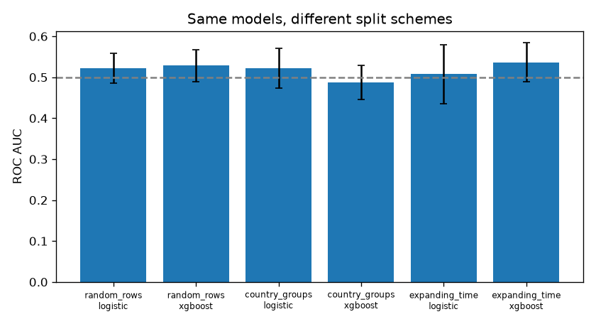

# Reproduction, leakage checks and ablation

Run on 24 November 2026 on a CPU only Linux machine with the versions in [requirements-lock.txt](../requirements-lock.txt). Runtime 1262 seconds.

```bash
pip install -r requirements-lock.txt
python -m research.reproduce_and_ablate --out results/research
```

Raw output: [research_report.json](../results/research/research_report.json) and [feature_group_ablation.csv](../results/research/feature_group_ablation.csv). The script reuses the loaders, features and model code of `run_evaluation.py` but never edits the thesis document. The hybrid LSTM model is left out because it is slow and TensorFlow training on CPU is not bit for bit repeatable.

Data used: 3010 rows, 68 countries, default rate 5.45%.

## 1. Reproducing the committed results

Each model was run twice in the same pinned environment and compared with `results/model_comparison_*.csv`.

| Split | Model | Committed ROC AUC | Rerun ROC AUC (run 1 / run 2) | Committed F1 | Rerun F1 | Reruns identical |
| --- | --- | --- | --- | --- | --- | --- |
| country | Probit | 0.5633 | 0.5894 / 0.5894 | 0.1207 | 0.1222 | yes |
| country | Logistic Regression | 0.5593 | 0.5854 / 0.5854 | 0.1099 | 0.1099 | yes |
| country | XGBoost | 0.4942 | 0.5564 / 0.5564 | 0.0995 | 0.0000 | yes |
| temporal | Probit | 0.5069 | 0.5230 / 0.5230 | 0.0804 | 0.0885 | yes |
| temporal | Logistic Regression | 0.5016 | 0.5141 / 0.5141 | 0.0775 | 0.0988 | yes |
| temporal | XGBoost | 0.5770 | 0.5662 / 0.5662 | 0.1036 | 0.0925 | yes |

With pinned versions the tabular models are now fully repeatable (both reruns identical). None of them matches the committed numbers to 4 decimal places, so the committed files came from a different environment or data state that cannot be recovered. The current loader returns 3,010 rows against the 3,011 described earlier. The conclusion is unchanged: every model is close to chance.

## 2. Leakage check: does the split scheme change the answer?



| Scheme | Model | Folds | Mean ROC AUC | Std |
| --- | --- | --- | --- | --- |
| Random rows (same country can be in train and test) | logistic | 25 | 0.522 | 0.037 |
| Random rows (same country can be in train and test) | xgboost | 25 | 0.528 | 0.040 |
| Country grouped 5 fold, 5 shuffles | logistic | 25 | 0.522 | 0.049 |
| Country grouped 5 fold, 5 shuffles | xgboost | 25 | 0.487 | 0.042 |
| Expanding window, train to year T, test T+1 to T+5 (T = 1995 to 2015) | logistic | 5 | 0.508 | 0.072 |
| Expanding window, train to year T, test T+1 to T+5 (T = 1995 to 2015) | xgboost | 5 | 0.536 | 0.048 |

On real panel data a random row split usually scores higher than a country or time split, because a model can learn each country's level. Here all three schemes sit at about 0.5, so there is no leakage gain to measure: there is no signal to leak.

## 3. Feature group ablation

Logistic regression and XGBoost (200 trees, depth 4) with 5 fold country grouped CV, repeated over 5 country shuffles (25 folds per row).

| Model | Variant | Mean ROC AUC | Std | Change vs all features |
| --- | --- | --- | --- | --- |
| logistic | all features | 0.522 | 0.049 | +0.000 |
| logistic | drop debt | 0.530 | 0.053 | +0.008 |
| logistic | only debt | 0.507 | 0.043 | -0.014 |
| logistic | drop domestic_macro | 0.534 | 0.049 | +0.013 |
| logistic | only domestic_macro | 0.493 | 0.052 | -0.029 |
| logistic | drop global | 0.503 | 0.041 | -0.019 |
| logistic | only global | 0.534 | 0.054 | +0.012 |
| logistic | drop political | 0.511 | 0.051 | -0.011 |
| logistic | only political | 0.534 | 0.036 | +0.013 |
| xgboost | all features | 0.487 | 0.042 | +0.000 |
| xgboost | drop debt | 0.487 | 0.045 | +0.000 |
| xgboost | only debt | 0.483 | 0.043 | -0.005 |
| xgboost | drop domestic_macro | 0.468 | 0.061 | -0.019 |
| xgboost | only domestic_macro | 0.507 | 0.050 | +0.019 |
| xgboost | drop global | 0.500 | 0.049 | +0.013 |
| xgboost | only global | 0.464 | 0.042 | -0.023 |
| xgboost | drop political | 0.485 | 0.045 | -0.002 |
| xgboost | only political | 0.502 | 0.052 | +0.014 |

Groups: debt = ExtDebt_GDP, DebtServ_XGDP; domestic_macro = RealGDP_growth, Inflation, fiscal_balance, Trade_openness; global = World_GDP_growth, Oil_price_index, US_FedFundsRate, VIX; political = ICRG_political, ElectionYear.

Every change is smaller than the fold to fold standard deviation (about 0.04 to 0.06), and removing a group sometimes raises the score. No feature group carries a measurable signal in this dataset.

## 4. Baselines on the temporal test window (after 2010)

| Model | ROC AUC | PR AUC |
| --- | --- | --- |
| Default last year (persistence) | 0.532 | 0.050 |
| Logistic regression, 12 features | 0.514 (95% bootstrap CI 0.414 to 0.614) | 0.071 |
| Chance | 0.500 | 0.044 |

The logistic model's AUC interval includes 0.5, and its difference from the persistence rule is -0.125 to +0.081 (95% CI), so neither beats the other. Only 11% of defaults in the test window followed a default the year before. Real sovereign defaults usually run for several years, so this is more evidence that the dataset is not real.

At a 0.5 threshold the class weighted logistic model is right where an always no default rule is wrong in 16 cases and wrong where that rule is right in 345 (McNemar p 1.3e-81). Accuracy is the wrong metric with a 5% default rate, which is why the main pipeline tunes thresholds and reports F1 and PR AUC.

## 5. Results by decade (out of fold, country grouped)

| Decade | Rows | Defaults | Default rate | ROC AUC |
| --- | --- | --- | --- | --- |
| 1980s | 700 | 47 | 0.067 | 0.532 |
| 1990s | 700 | 35 | 0.050 | 0.388 |
| 2000s | 700 | 40 | 0.057 | 0.582 |
| 2010s | 700 | 37 | 0.053 | 0.571 |
| 2020s | 210 | 5 | 0.024 | 0.414 |

The score swings from below to above 0.5 between decades, which is what noise looks like with 35 to 47 defaults per decade. The 2020s have only 5 defaults.

## What this means for the thesis

The evaluation method (country and time splits, threshold tuning on training data, F1 and PR AUC) is sound, and the code now reruns identically. The data is the problem. Tracing or replacing the dataset with a documented source is the step that would make any model comparison meaningful.
